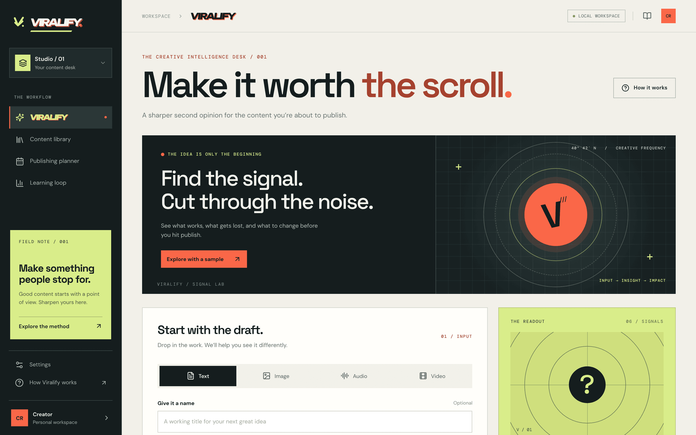
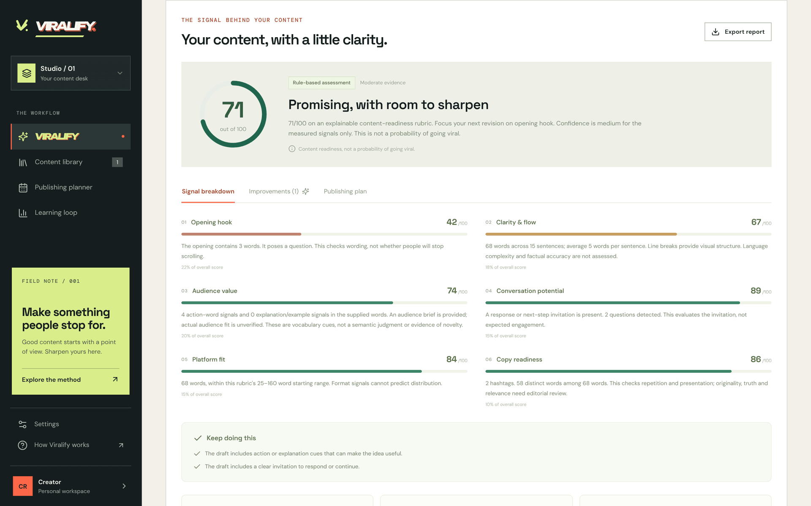
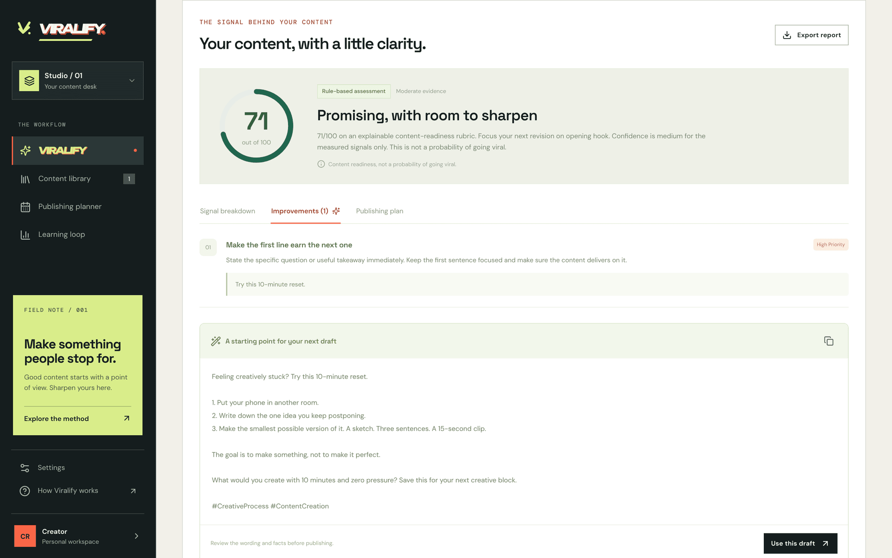
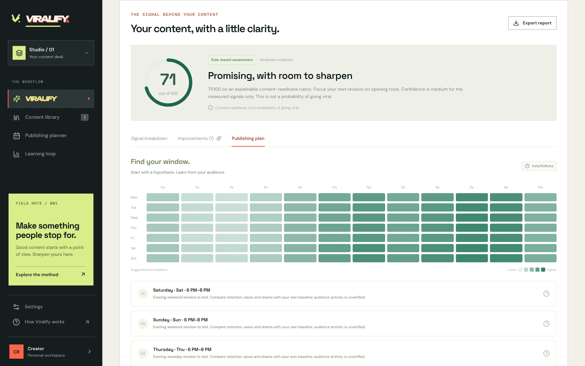
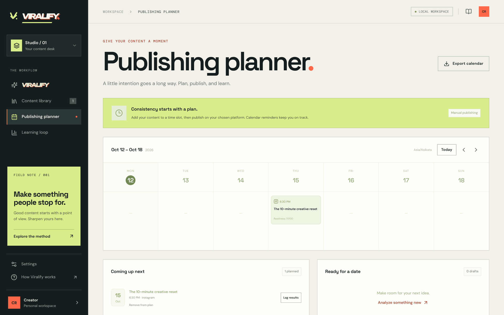
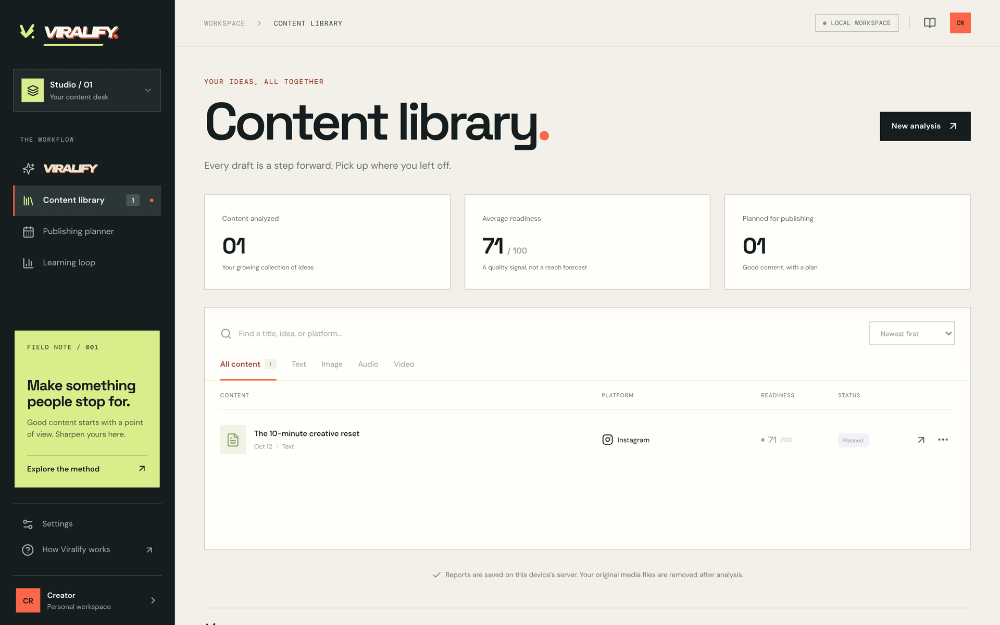
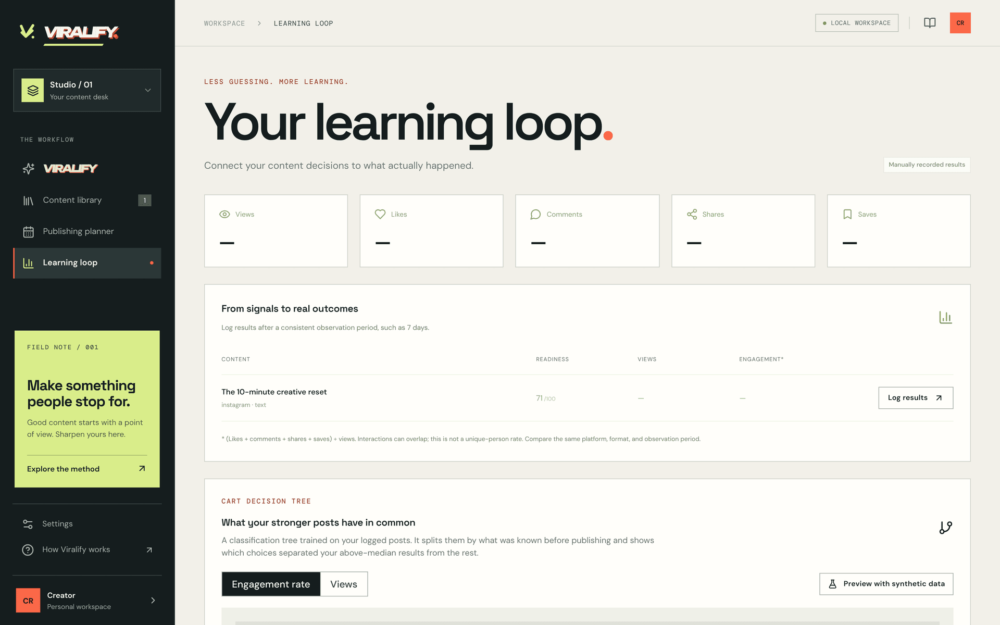
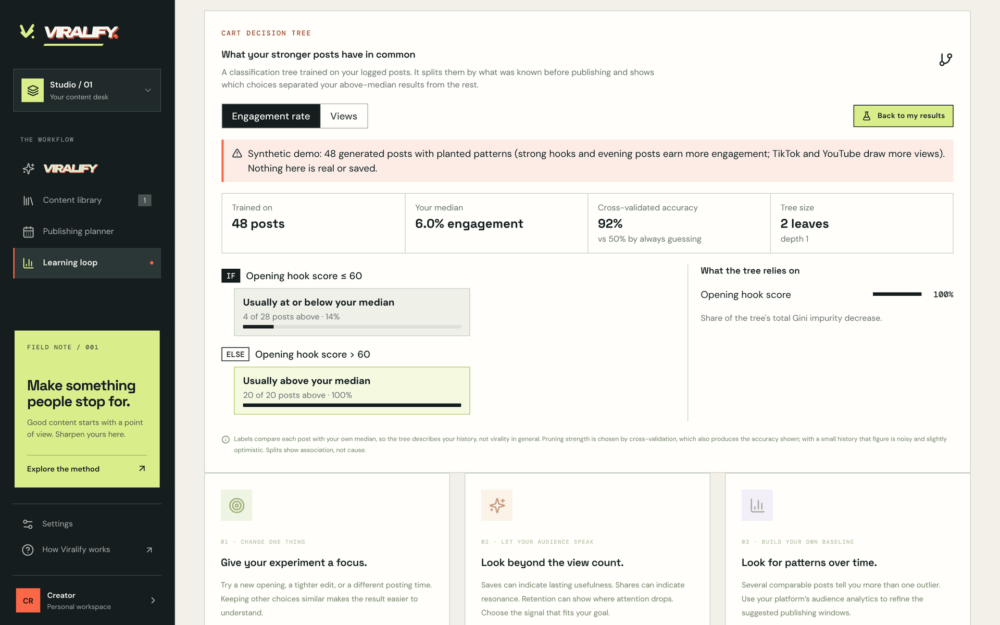
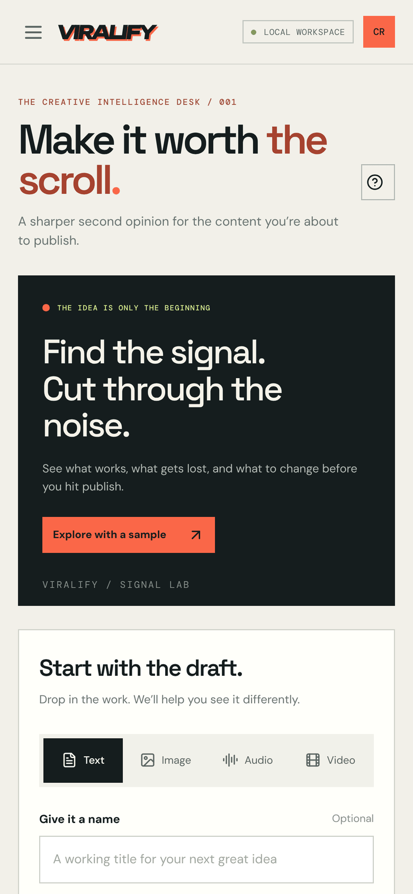

<div align="center">


# Viralify

### Make it worth the scroll.

Understand your content, improve your next draft, and find a publishing window worth testing.

[](https://viralify-gamma.vercel.app/)
[](https://github.com/harshh-2505/Viralify/actions/workflows/ci.yml)


[**Open the app**](https://viralify-gamma.vercel.app/) · [Methodology](docs/methodology.md) · [API reference](docs/api.md) · [Run locally](#run-locally)

<br />



</div>

---

Viralify reviews **text, images, audio, and video before publishing**. Give it a draft or upload, choose a platform and audience, and it explains which content signals are strong, what needs work, and what to try next.

It turns “Will this go viral?” into a practical editing loop:

<p align="center"><b>analyze</b> → <b>improve</b> → <b>plan</b> → <b>publish</b> → <b>learn</b></p>

You get an explainable readiness score, prioritized suggestions, alternative hooks, a revised draft, publishing-time experiments, and a place to track real results.

> [!IMPORTANT]
> **The score is a heuristic content assessment, not a probability of going viral.** There is no trained virality model, live trend feed, or connected audience analytics; the only trained model is a per-creator decision tree over your own logged results. Optional AI adds semantic feedback; it does not make reach predictable.

> [!NOTE]
> The live app is hosted on Vercel and automatically deploys updates to `main`. It currently runs without an AI API key: text heuristics and real media inspection work immediately, with reports kept in your browser. Hosted uploads are limited to 4 MB per file.

## Screenshots

<table>
  <tr>
    <td width="50%" valign="top">
      
      <p align="center"><b>Explainable readiness score</b><br /><sub>Six weighted signals, each with its evidence.</sub></p>
    </td>
    <td width="50%" valign="top">
      
      <p align="center"><b>Optimization feedback</b><br /><sub>Prioritized edits and a revised draft to reanalyze.</sub></p>
    </td>
  </tr>
  <tr>
    <td width="50%" valign="top">
      
      <p align="center"><b>Publishing windows</b><br /><sub>A seven-day heatmap and three windows to test.</sub></p>
    </td>
    <td width="50%" valign="top">
      
      <p align="center"><b>Publishing planner</b><br /><sub>Schedule drafts and export an <code>.ics</code> calendar.</sub></p>
    </td>
  </tr>
  <tr>
    <td width="50%" valign="top">
      
      <p align="center"><b>Content library</b><br /><sub>Search, filter, reopen, and export reports.</sub></p>
    </td>
    <td width="50%" valign="top">
      
      <p align="center"><b>Learning loop</b><br /><sub>Log real results after publishing.</sub></p>
    </td>
  </tr>
  <tr>
    <td width="50%" valign="top">
      
      <p align="center"><b>CART decision tree</b><br /><sub>Shown here with the built-in synthetic-data preview.</sub></p>
    </td>
    <td width="50%" valign="top" align="center">
      
      <p align="center"><b>Responsive</b><br /><sub>The full workspace works on a phone.</sub></p>
    </td>
  </tr>
</table>

## What the project does

|     | Feature                   | What you get                                                                                                                                                                                                                                                                                                                                                                                                                                                         |
| :-: | ------------------------- | -------------------------------------------------------------------------------------------------------------------------------------------------------------------------------------------------------------------------------------------------------------------------------------------------------------------------------------------------------------------------------------------------------------------------------------------------------------------- |
| 🔍  | **Content analyzer**      | Assesses opening-hook wording, clarity, useful-detail signals, calls to action, platform fit, and copy/media readiness. Each dimension shows its evidence and weight.                                                                                                                                                                                                                                                                                                |
| ✍️  | **Optimization feedback** | Specific edits, examples, alternative hooks, and a revised draft you can apply and reanalyze. Revisions are saved separately for comparison.                                                                                                                                                                                                                                                                                                                         |
| 🎞️  | **Multimodal inspection** | Decodes actual files with Sharp and FFmpeg. Optional AI adds image/frame interpretation and speech transcription.                                                                                                                                                                                                                                                                                                                                                    |
| 🗓️  | **Publishing planner**    | A seven-day heatmap and three two-hour windows to test in your audience's timezone. Save a future date and export an `.ics` calendar event. Missing or ambiguous daylight-saving times are rejected.                                                                                                                                                                                                                                                                 |
| 📚  | **Content library**       | Saves reports, supports search and type filters, opens earlier analyses, and exports complete Markdown reports.                                                                                                                                                                                                                                                                                                                                                      |
| 📈  | **Learning loop**         | Records actual views, likes, comments, shares, and saves. Engagement is interactions divided by views, not unique people reached.                                                                                                                                                                                                                                                                                                                                    |
| 🌳  | **Decision tree (CART)**  | After 10 posts have logged results, trains a pruned classification tree in the browser that shows which pre-publishing choices separated your above-median posts from the rest, with cross-validated accuracy against a guessing baseline. New reports show the matching rule when the tree beats that baseline. A synthetic-data preview demonstrates it before real results exist. See [methodology](docs/methodology.md#decision-tree-on-your-own-outcomes-cart). |

Media without a caption or transcript receives a **technical-only assessment**. Unavailable wording dimensions are marked “Not assessed” and excluded. This score is not directly comparable with a full content assessment.

**Platform profiles:** Instagram, TikTok, YouTube, LinkedIn, and X. These are editorial starting points, not reverse-engineered recommendation algorithms.

## Run locally

Use **Node.js 22** and npm:

```sh
npm install
npm run dev
```

Open [localhost:5173](http://localhost:5173). React/Vite runs on port 5173 and Express on port 3001. Vite proxies `/api` to the local server. Both bind to the local machine by default.

For the built application:

```sh
npm run build
npm start
```

Open [localhost:3001](http://localhost:3001).

```sh
npm test
npm run typecheck
npm run build
```

Installation includes Sharp and a platform-specific FFmpeg executable. If the FFmpeg download is blocked, install it separately and set `FFMPEG_PATH`. Text and image analysis do not require FFmpeg.

## Typical workflow

1. **Draft.** Paste a draft or select a file. Add a caption or transcript for context.
2. **Target.** Choose your platform, objective, audience, and audience timezone.
3. **Analyze.** Review the highest-priority improvements.
4. **Revise.** Adapt suggested wording to your voice, verify factual claims, and analyze the revision.
5. **Plan.** Save a publishing date, export your calendar, and publish on the platform yourself.
6. **Learn.** After a consistent observation period, such as seven days, log real results and compare similar posts.

Viralify does **not** publish posts, send reminders, or connect to social accounts. Its calendar is a plan you can export to a calendar application. Outcomes are entered manually. Preferences use browser `localStorage`.

## Supported content and limits

| Input | Upload interface                   | Rule-based analysis                                                                |
| ----- | ---------------------------------- | ---------------------------------------------------------------------------------- |
| Text  | Draft, caption, script, transcript | Wording, hook structure, clarity, specificity, next steps, and platform fit        |
| Image | JPEG, PNG, WebP, GIF               | Decoded dimensions, aspect ratio, brightness, and contrast                         |
| Audio | MP3, WAV, M4A, OGG, WebM, FLAC     | Duration, sampled silence ratio, and audio peak measurements                       |
| Video | MP4, WebM, MOV                     | Duration, dimensions, opening-frame measurements, and available audio measurements |

- **Local uploads:** 50 MiB, shown as 50 MB.
- **Vercel uploads:** 4,000,000 bytes (4 MB). This leaves room for metadata under the function request limit. The UI reads the exact server cap.
- **Text analysis:** 20–30,000 characters. Captions for media are optional.
- **Audio/video:** readable duration up to 20 minutes. Signal measurements sample the first two minutes; optional transcription covers the first three minutes.
- **Image/video dimensions:** up to 40 million pixels; video dimensions cannot exceed 8192 pixels. Animated images use the first frame.
- **AI video review:** three sampled frames near the opening, 40%, and 80% points, not every frame or edit.

Preview support varies by browser codec. The server checks actual decodability. Without AI, subjects, embedded image text, music quality, speech tone, and visual storytelling are not semantically assessed. Wording cues currently focus on English.

## Optional AI review

The app works without an API key. Locally, copy `.env.example` to `.env`, set `OPENAI_API_KEY`, and restart:

```powershell
Copy-Item .env.example .env
```

| Variable                     | Default                     | Purpose                                                                    |
| ---------------------------- | --------------------------- | -------------------------------------------------------------------------- |
| `PORT`                       | `3001`                      | Local API/built-app port                                                   |
| `HOST`                       | `127.0.0.1`                 | Local listen address                                                       |
| `OPENAI_API_KEY`             | Empty                       | Enables AI feedback and transcription                                      |
| `AI_ACCESS_CODE`             | Empty                       | Required with the API key on the public deployment; unlocks private AI use |
| `OPENAI_MODEL`               | `gpt-4.1-mini`              | Semantic review model                                                      |
| `OPENAI_TRANSCRIPTION_MODEL` | `gpt-4o-mini-transcribe`    | Speech transcription model                                                 |
| `FFMPEG_PATH`                | Bundled executable          | Optional absolute FFmpeg path                                              |
| `ALLOWED_ORIGINS`            | Loopback/deployment origins | Comma-separated exact origins, for custom HTTPS domains                    |

The API key and access code stay in server environment variables. On Vercel, AI stays off unless both are set. Enter the access code in profile settings; the browser keeps it for that session and sends it only to Viralify's API. Visitors without the code continue to get local analysis. With AI enabled, text, context, measurements, images/video frames, and extracted audio may go to OpenAI. Usage charges and access depend on your API account. Never prefix secrets with `VITE_`.

Without a key, the server performs rule-based analysis without an AI provider. **On the hosted app, content still goes to the hosted server for processing.** AI supplements editorial feedback; numeric scores retain the transparent rubric. Provider failures fall back with an explicit limitation.

The integration follows OpenAI's [vision guide](https://developers.openai.com/api/docs/guides/images-vision), [transcription guide](https://developers.openai.com/api/docs/guides/speech-to-text), and [Structured Outputs guide](https://developers.openai.com/api/docs/guides/structured-outputs).

## Storage and privacy

| Mode                            | Analysis execution      | Report storage                      |
| ------------------------------- | ----------------------- | ----------------------------------- |
| Local development / `npm start` | Local Express server    | `data/analyses.json`                |
| Vercel                          | Stateless Node function | IndexedDB in each visitor's browser |

**The hosted server has no shared user library.** It returns results to the requesting browser and disables server-side library endpoints. Reports survive reloads for that browser and site origin, but do not sync across devices, browsers, or deployment domains. Clearing site data removes them, so export reports you want to keep. Storage failures are surfaced instead of hidden by a temporary memory fallback.

Local disk mode is for one user and one server process; keep the loopback binding. Writes are serialized and saved atomically. Corrupt data raises an error and is not silently overwritten. Stop the server before restoring a backup.

Original media is not retained in the library. Images are decoded in memory; audio/video uses generated temporary directories (`/tmp` on Vercel), removed after success or failure. A crash or hard platform timeout can interrupt cleanup. Preview object URLs are released when files change or the component unmounts.

There is no account system, cloud database, or social connection. Before enabling a shared paid AI service, add authentication, persistent rate limits, and usage quotas. Origin checks alone are not authentication.

Secrets, `.vercel` linkage, dependencies, builds, and local data are excluded from Git. Deleting a report does not delete your original file.

## Deploy to Vercel

1. Import this repository. Use **Vite**, Node.js **22.x**, build command `npm run build`, and output directory `dist`. `vercel.json` supplies build and routing settings.
2. Deploy without a key for the working rule-based version. No database is required.
3. `api/index.ts` runs as a Node function with Linux FFmpeg and Sharp. `/api/*` routes to it; media processing uses temporary files.
4. To enable private AI, set `OPENAI_API_KEY` and a random `AI_ACCESS_CODE` of 32–128 characters in Vercel's server environment variables, then redeploy. Set an API project spend limit as a backstop. Keep both values private; do not put them in Git or `VITE_` variables.
5. Check `/api/health`: expect `storageMode: "browser"`, `maxUploadBytes: 4000000`, and `mediaEnabled: true`. Analyze an example, reload, and check the library persists.

For a custom domain not supplied by Vercel's environment, set its exact HTTPS origin in `ALLOWED_ORIGINS` and redeploy. Do not use a wildcard.

[Vercel function limits](https://vercel.com/docs/functions/limitations) apply. Large-video production workflows need direct object-storage uploads and a background queue.

## Technology and verification

React 19, TypeScript, Vite, Express 5, Zod, Sharp, FFmpeg, and native IndexedDB. Optional OpenAI calls use server credentials and validated structured responses.

Tests cover scoring, revision integrity, real media decoding, request validation, disk/browser persistence, corruption preservation, browser isolation, scheduling, daylight-saving transitions, Markdown reports, and RFC 5545 calendar escaping/folding. Provider responses are simulated in tests; live AI requires a configured key. GitHub Actions runs tests and the production build.

```text
src/                       React workspace
src/lib/                   API, IndexedDB, timezones, exports
server/                    Scoring, decoding, AI, validation, disk storage
shared/types.ts            Request/result contracts
api/index.ts               Stateless Vercel function
vercel.json                Build, native dependencies, API routing
tests/                     Automated tests
docs/                      Methodology and API reference
.github/workflows/ci.yml    CI workflow
```

## Troubleshooting

- **API unavailable:** run `npm run dev` and inspect both API and Vite logs. If changing port 3001, update Vite's proxy too.
- **Media rejected:** check size/duration and export a standard supported format.
- **FFmpeg unavailable:** reinstall dependencies or set `FFMPEG_PATH` locally; check native-binary inclusion on Vercel.
- **AI fallback:** inspect report limitations, the server key, and model access. Never paste credentials into content fields.
- **Browser library unavailable:** allow IndexedDB, check free storage, and close other tabs if an upgrade is blocked. Export before clearing site data.
- **Local library corrupt:** preserve the file and restore a known-good backup while the server is stopped.
